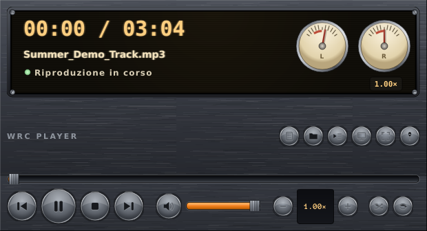
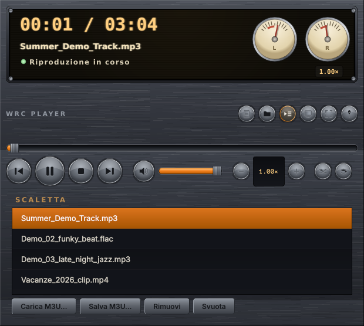
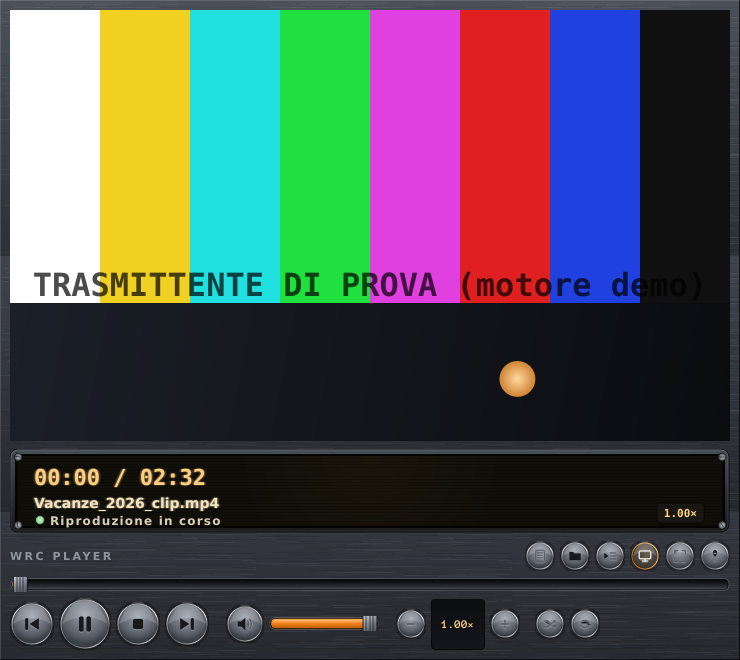

# WRCPlayer

[English](README.md) | **Italiano**




WRCPlayer è un lettore multimediale skeuomorfo per Windows: metallo spazzolato,
LCD ambra, VU analogici e pulsanti cromati. L'audio è riprodotto da **Windows
Media Player Legacy** (via COM) e il video da **Qt Multimedia (FFmpeg)**. Se
Windows Media Player Legacy manca, riproduce tutto Qt.

La W sta per Windows. Per Linux vedi
[RCVPlayer](https://github.com/MrGodLink/RCVPlayer).

## Caratteristiche
- Layout automatico: i file audio usano una finestra minimale, i file video
  aprono il pannello video (si cambia a mano con `V`)
- Schermo intero: i controlli spariscono insieme al cursore dopo 2,5 s e
  tornano al movimento del mouse; doppio clic sul video per attivarlo
- Playlist con drag & drop (file e cartelle), carica/salva M3U
- Casuale, ripeti (tutto / brano), velocità da 0,5× a 2,0×
- Sempre in primo piano, apri cartella, impostazioni ricordate tra le sessioni
- Ripiega su Qt quando Windows Media Player non decodifica un file
- I VU sono decorativi (l'interfaccia COM non espone i livelli reali)

| Audio | Video |
|-------|-------|
| mp3, aac, m4a, wma, wav, flac, ogg, opus, mid, aiff, ape, mka | mp4, mkv, avi, wmv, mov, webm, mpg, ts, m2ts, 3gp, flv, ogv, vob |




## Requisiti
- Windows 10 o 11, Python 3.10+
- Windows Media Player Legacy (facoltativo, consigliato per l'audio). Si attiva
  da *Impostazioni > Sistema > Funzionalità facoltative > Windows Media Player
  Legacy*. Sulle edizioni N di Windows installa prima il *Media Feature Pack*.

## Avvio dal sorgente
```bash
pip install -r requirements.txt
python main.py
```

Variabili d'ambiente: `WRC_ENGINE=qt` salta Windows Media Player e usa solo Qt;
`WRC_MOCK=1` avvia il motore demo (funziona anche fuori da Windows).

## Creare un eseguibile
```bat
build.bat
```
Crea `dist\WRCPlayer\WRCPlayer.exe` con PyInstaller (finestra, senza console).

## Scorciatoie da tastiera
| Tasto | Azione |
|-----|--------|
| `Space` | Play / pausa |
| `Left` / `Right` | Salta 5 s (`Shift`: 30 s) |
| `Up` / `Down` | Volume |
| `M` | Muto |
| `N` / `P` | Brano successivo / precedente |
| `S` / `R` | Casuale / ripeti |
| `[` / `]` | Velocità − / + |
| `F` | Schermo intero |
| `Esc` | Esci dallo schermo intero |
| `T` | Sempre in primo piano |
| `L` | Mostra/nascondi playlist |
| `V` | Mostra/nascondi pannello video |
| `Ctrl+O` | Apri file |
| `Ctrl+Shift+O` | Apri cartella |

## Contenuto del repository
| File | Scopo |
|------|---------|
| `main.py` | Punto di ingresso |
| `player.py` | Finestra principale e logica di riproduzione |
| `controls.py` | Widget skeuomorfi (pulsanti, slider, VU, LCD) |
| `theme.py` | Palette, font, utilità grafiche |
| `appicon.py` | Icona dipinta a runtime |
| `wmp_engine.py` | Motore Windows Media Player Legacy (COM) |
| `qt_engine.py` | Motore Qt Multimedia |
| `mock_engine.py` | Motore demo |
| `playlist.py` | Pannello playlist |
| `scripts/` | Generatori di icone e schermate |

## Crediti
Creato da **Raffaele Catapano** - [github.com/MrGodLink](https://github.com/MrGodLink)

### Altri progetti dell'autore
- [RCVPlayer](https://github.com/MrGodLink/RCVPlayer) - lettore multimediale per Linux
- [Claude-Disciplined-Coding](https://github.com/MrGodLink/Claude-Disciplined-Coding) - skill per Claude: ragionamento prima del codice, modifiche minime, ipotesi esplicite
- [Claude-Token-Meter](https://github.com/MrGodLink/Claude-Token-Meter) - skill per Claude: barra colorata con i token di contesto rimasti
- [Claude-Token-Saver](https://github.com/MrGodLink/Claude-Token-Saver) - skill per Claude: meno token consumati in chat
- [MIDI-Studio](https://github.com/MrGodLink/MIDI-Studio) - lettore MIDI e convertitore MIDI-MP3
- [OSINT-Tracker](https://github.com/MrGodLink/OSINT-Tracker) - strumento di open source intelligence (OSINT)
- [RcFux](https://github.com/MrGodLink/RcFux) - utility grafica per creare chiavette USB avviabili su Linux
- [CISO-Converter](https://github.com/MrGodLink/CISO-Converter) - convertitore ISO-CSO e CSO-ISO

## Licenza
MIT, vedi [LICENSE](LICENSE). I componenti di terze parti restano sotto le
rispettive licenze: vedi [THIRD_PARTY.md](THIRD_PARTY.md). Windows Media Player
non è distribuito con questo progetto.
