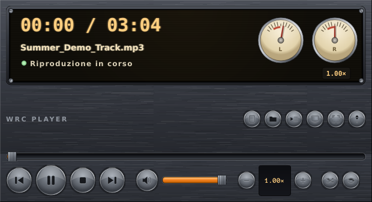
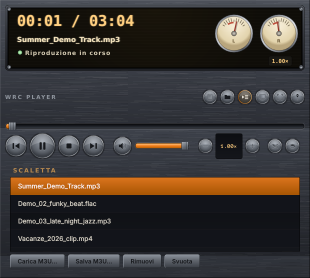
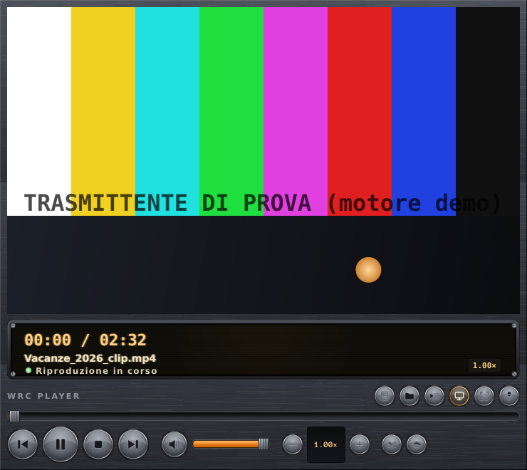

# WRCPlayer

**English** | [Italiano](README.it.md)




WRCPlayer is a skeuomorphic media player for Windows: brushed metal, amber LCD,
analog VU dials and chrome buttons. Audio is played by **Windows Media Player
Legacy** (via COM) and video by **Qt Multimedia (FFmpeg)**. If Windows Media
Player Legacy is missing, everything is played by Qt.

W stands for Windows. For the Linux player see
[RCVPlayer](https://github.com/MrGodLink/RCVPlayer).

## Features
- Automatic layout: audio files keep a minimal window, video files open the
  video panel (toggle manually with `V`)
- Fullscreen: controls fade out with the cursor after 2.5 s, return on mouse
  move; double-click the video to toggle
- Playlist with drag & drop (files and folders), load/save M3U
- Shuffle, repeat (all / one), speed from 0.5x to 2.0x
- Always on top, open folder, settings remembered between runs
- Falls back to Qt when Windows Media Player cannot decode a file
- VU dials are decorative (the COM interface does not expose real levels)

| Audio | Video |
|-------|-------|
| mp3, aac, m4a, wma, wav, flac, ogg, opus, mid, aiff, ape, mka | mp4, mkv, avi, wmv, mov, webm, mpg, ts, m2ts, 3gp, flv, ogv, vob |




## Requirements
- Windows 10 or 11, Python 3.10+
- Windows Media Player Legacy (optional, recommended for audio). Enable it in
  *Settings > System > Optional features > Windows Media Player Legacy*.
  On N editions of Windows install the *Media Feature Pack* first.

## Run from source
```bash
pip install -r requirements.txt
python main.py
```

Environment variables: `WRC_ENGINE=qt` skips Windows Media Player and uses Qt
only; `WRC_MOCK=1` starts the demo engine (also works outside Windows).

## Build an executable
```bat
build.bat
```
Creates `dist\WRCPlayer\WRCPlayer.exe` with PyInstaller (windowed, no console).

## Keyboard shortcuts
| Key | Action |
|-----|--------|
| `Space` | Play / pause |
| `Left` / `Right` | Seek 5 s (`Shift`: 30 s) |
| `Up` / `Down` | Volume |
| `M` | Mute |
| `N` / `P` | Next / previous track |
| `S` / `R` | Shuffle / repeat |
| `[` / `]` | Speed down / up |
| `F` | Fullscreen |
| `Esc` | Leave fullscreen |
| `T` | Always on top |
| `L` | Show / hide playlist |
| `V` | Show / hide video panel |
| `Ctrl+O` | Open files |
| `Ctrl+Shift+O` | Open folder |

## Project layout
| File | Purpose |
|------|---------|
| `main.py` | Entry point |
| `player.py` | Main window and playback logic |
| `controls.py` | Skeuomorphic widgets (buttons, sliders, VU, LCD) |
| `theme.py` | Palette, fonts, drawing helpers |
| `appicon.py` | Icon painted at runtime |
| `wmp_engine.py` | Windows Media Player Legacy engine (COM) |
| `qt_engine.py` | Qt Multimedia engine |
| `mock_engine.py` | Demo engine |
| `playlist.py` | Playlist panel |
| `scripts/` | Icon and screenshot generators |

## Credits
Created by **Raffaele Catapano** - [github.com/MrGodLink](https://github.com/MrGodLink)

### Other projects by the author
- [RCVPlayer](https://github.com/MrGodLink/RCVPlayer) - media player for Linux
- [Claude-Disciplined-Coding](https://github.com/MrGodLink/Claude-Disciplined-Coding) - Claude skill: reasoning before code, minimal changes, explicit assumptions
- [Claude-Token-Meter](https://github.com/MrGodLink/Claude-Token-Meter) - Claude skill: colored bar with the remaining context tokens
- [Claude-Token-Saver](https://github.com/MrGodLink/Claude-Token-Saver) - Claude skill: lower token usage in chat
- [MIDI-Studio](https://github.com/MrGodLink/MIDI-Studio) - MIDI player and MIDI-to-MP3 converter
- [OSINT-Tracker](https://github.com/MrGodLink/OSINT-Tracker) - open source intelligence tool
- [RcFux](https://github.com/MrGodLink/RcFux) - graphical utility to create bootable USB drives on Linux
- [CISO-Converter](https://github.com/MrGodLink/CISO-Converter) - ISO to CSO and CSO to ISO converter

## License
MIT, see [LICENSE](LICENSE). Third-party components keep their own licenses:
see [THIRD_PARTY.md](THIRD_PARTY.md). Windows Media Player is not distributed
with this project.
